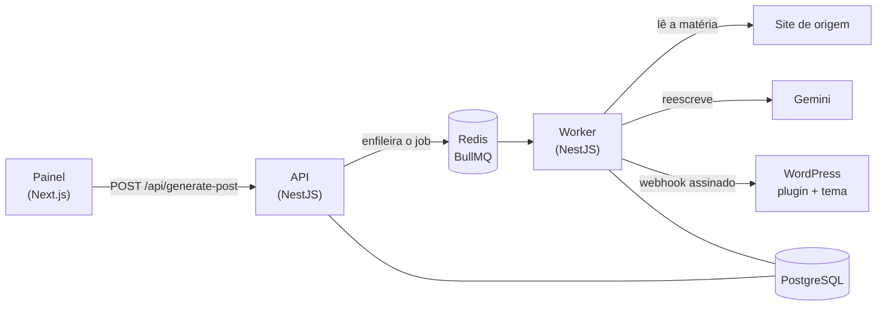

# Project News

Recebe a URL de uma matéria jornalística, reescreve o conteúdo com IA (Google Gemini) e publica o resultado como post no WordPress.

- [Projeto](#projeto): o que faz, como rodar e decisões gerais
- [API](#api): a API e o worker, em NestJS
- [WordPress](#wordpress): o plugin, o tema e a configuração automática
- [Painel](#painel): a interface em Next.js

---

## Projeto

### O que faz



1. Um cliente envia a URL da matéria para `POST /api/generate-post`. O cliente pode ser o painel, o Postman ou um `curl`. A API valida a URL, cria um job no PostgreSQL, coloca o job na fila e responde na hora com `202`.
2. O worker pega o job, baixa a página e extrai o texto da matéria.
3. O Gemini reescreve o texto e devolve um JSON com título, resumo, seções, pontos principais, tags, editoria, meta description e a imagem de destaque escolhida entre as fotos da matéria.
4. O worker monta o post e o envia ao WordPress por um webhook assinado com HMAC.
5. O plugin confere a assinatura e cria o post com categoria, tags, imagem de destaque e o crédito da fonte original.
6. O tema exibe a matéria. O painel mostra o andamento de cada etapa enquanto o job roda.

| Parte | Pasta | Stack |
|---|---|---|
| [API e worker](#api) | `api/` | NestJS 12, Prisma 7, PostgreSQL, BullMQ 6, Redis, Gemini |
| [Plugin e tema](#wordpress) | `wordpress/` | WordPress 7.1, PHP 8.4, Bootstrap 5.3, Sass, Vite 8 |
| [Painel](#painel) | `dashboard/` | Next.js 16, React 19, shadcn/ui, Tailwind CSS 4, React Query |

```
.
├── api/                                API (NestJS) e worker
├── dashboard/                          Painel (Next.js)
├── docs/                               Collection do Postman e do Insomnia
├── wordpress/
│   ├── plugins/project-news-receiver/  Plugin que recebe o webhook e cria os posts
│   ├── themes/project-news/            Tema
│   └── setup.sh                        Configuração automática do WordPress
├── docker-compose.yml
└── .env.example                        Segredo do webhook e portas (opcional)
```

### Como rodar

Requisitos:

- Docker com Docker Compose 2.24 ou mais novo.
- Uma chave do Gemini. Ela é gratuita e pode ser gerada no [Google AI Studio](https://aistudio.google.com/apikey).

Cada `.env` do projeto é criado a partir do `.env.example` da mesma pasta. O `.env.example` lista todas as variáveis, com valores que já funcionam no ambiente local. Os `.env` ficam fora do git.

| Arquivo | Criado a partir de | Quando é preciso |
|---|---|---|
| `api/.env` | `api/.env.example` | Sempre, porque é onde fica a `GEMINI_API_KEY` |
| `.env` (raiz) | `.env.example` | Só para trocar o segredo do webhook ou alguma porta |
| `dashboard/.env` | `dashboard/.env.example` | Só para rodar o painel fora do Docker |

Passo a passo:

1. Crie o `api/.env` a partir do `api/.env.example` e preencha a `GEMINI_API_KEY`:

    ```bash
    cp api/.env.example api/.env
    ```

2. Suba tudo:

    ```bash
    docker compose --profile app up -d --build
    ```

Na primeira vez, o compose faz o seguinte antes de liberar a aplicação, e isso leva alguns minutos:

- compila os assets do tema;
- instala e configura o WordPress, com idioma, links permanentes, usuário autor, plugin e tema;
- aplica as migrations do banco da API.

| Serviço | Endereço |
|---|---|
| Painel | http://localhost:3000 |
| API | http://localhost:3333/api |
| Documentação da API (Swagger) | http://localhost:3333/docs |
| Fila (Bull Board) | http://localhost:3333/queues |
| WordPress | http://localhost:8080 |
| Admin do WordPress | http://localhost:8080/wp-admin (usuário `admin`, senha `admin`) |

Para testar sem o painel, envie uma matéria pela API:

```bash
curl -X POST http://localhost:3333/api/generate-post \
  -H 'Content-Type: application/json' \
  -d '{"url": "https://g1.globo.com/..."}'
```

A resposta traz o `id` do job. Acompanhe o job em `GET http://localhost:3333/api/jobs/{id}` até o status `PUBLISHED`. Nesse status, o job traz o `permalink` do post no WordPress.

#### Collection do Postman e do Insomnia

O arquivo [`docs/project-news.postman_collection.json`](docs/project-news.postman_collection.json) traz todas as rotas da API e o webhook do plugin.

- **Postman:** use **Import** e escolha o arquivo.
- **Insomnia:** use **Import › From File**. O Insomnia aceita collections do Postman.

| Pasta | Requisições |
|---|---|
| API | Health, Gerar matéria, Listar jobs, Detalhe do job e Tentar de novo |
| API › Erros esperados | URL inválida (`400`), URL da rede interna (`422`) e job inexistente (`404`) |
| WordPress (plugin) | Criar post com o webhook assinado e um envio com assinatura inválida (`401`) |

Como usar:

- **Acompanhar uma matéria:** o **Gerar matéria** salva o id do job na variável `jobId`. Use **Detalhe do job** até o status `PUBLISHED`.
- **Webhook do plugin:** a requisição **Criar post** é assinada por um script que roda antes do envio, com o segredo da variável `webhookSecret`. O post é criado como rascunho. Se você mandar o mesmo post de novo, o plugin responde `200` com o post que já existe.

As variáveis da collection apontam para o ambiente local:

| Variável | Padrão |
|---|---|
| `apiUrl` | `http://localhost:3333/api` |
| `wordpressUrl` | `http://localhost:8080` |
| `webhookSecret` | `local-dev-webhook-secret`. Precisa ser igual ao `WORDPRESS_WEBHOOK_SECRET` do `.env` da raiz. |
| `articleUrl` | Uma matéria do g1, enviada em **Gerar matéria** |
| `jobId` | Preenchida por **Gerar matéria** |

Cada requisição tem testes do status esperado, então dá para rodar a collection inteira pelo Runner do Postman ou pelo terminal:

```bash
npx newman run docs/project-news.postman_collection.json
```

Se o `.env` da raiz define outro segredo, passe o valor com `--env-var webhookSecret=<segredo>`.

A rota de geração aceita 5 envios por minuto, e uma execução da collection usa 3 deles. Para rodar de novo logo em seguida, espere um minuto.

#### Só a infraestrutura no Docker

Sem o profile `app`, o comando abaixo sobe só o PostgreSQL, o Redis, o MySQL e o WordPress:

```bash
docker compose up -d
```

A API, o worker e o painel rodam na sua máquina. A seção de cada parte explica como.

#### Configuração da raiz

O `.env` da raiz é opcional. Sem ele, o compose usa os valores padrão. Para criá-lo, copie o `.env.example` e mude só o que precisar:

```bash
cp .env.example .env
```

| Variável | Padrão | Para que serve |
|---|---|---|
| `WORDPRESS_WEBHOOK_SECRET` | `local-dev-webhook-secret` | Segredo do HMAC, compartilhado pela API e pelo WordPress. Veja [como gerar um](#segredo-do-webhook). |
| `POSTGRES_PORT` | `5433` | Porta do PostgreSQL no host |
| `REDIS_PORT` | `6380` | Porta do Redis no host |
| `MYSQL_PORT` | `3307` | Porta do MySQL no host |
| `WORDPRESS_PORT` | `8080` | Porta do WordPress no host |
| `API_PORT` | `3333` | Porta da API no host |
| `DASHBOARD_PORT` | `3000` | Porta do painel no host |

As portas só mudam o lado do host. Dentro da rede do compose, os serviços se encontram pelo nome (`postgres:5432`, `http://wordpress`, `http://api:3333/api`). Por isso esses endereços ficam no `docker-compose.yml`, e não no `.env`.

##### Segredo do webhook

Para gerar um segredo novo para o `WORDPRESS_WEBHOOK_SECRET`, rode o comando abaixo. Ele gera 32 bytes aleatórios em hexadecimal, ou seja, 64 caracteres:

```bash
node -e "console.log(require('node:crypto').randomBytes(32).toString('hex'))"
```

Coloque o valor no `WORDPRESS_WEBHOOK_SECRET` do `.env` da raiz. Se a API rodar fora do Docker, use o mesmo valor no `api/.env`, porque os dois precisam ser iguais. Sem `.env`, os dois usam o mesmo padrão.

#### Parar

```bash
docker compose --profile app down
```

Com `down -v`, o compose também apaga os volumes: os bancos, os arquivos do WordPress e o Redis.

### Decisões gerais

**Um repositório, três partes independentes.** Cada parte tem as próprias dependências e o próprio build. As partes só se falam por HTTP: o painel chama a API, e a API chama o WordPress. Dá para trocar ou escalar uma parte sem mexer nas outras.

**Processamento assíncrono.** Ler a página, chamar o Gemini e publicar no WordPress leva alguns segundos e depende de três serviços externos. Por isso `POST /api/generate-post` não espera esse trabalho: cria um job e responde `202`, e um worker separado processa o job. Assim:

- a requisição não corre risco de timeout;
- falhas temporárias são repetidas automaticamente;
- a fila controla o ritmo das chamadas e respeita a cota do Gemini.

**API e worker no mesmo código, em processos separados.** Os dois usam a mesma imagem Docker, com entrypoints diferentes (`main.js` e `worker.js`). O worker pode ganhar réplicas sem duplicar a API.

**PostgreSQL para a API, MySQL para o WordPress.** O histórico de jobs fica no PostgreSQL, com Prisma e migrations. O WordPress continua no MySQL, que é o banco que ele suporta. Nenhuma parte acessa o banco da outra.

**Redis e BullMQ para a fila.** O BullMQ já traz tentativas com backoff exponencial, limite de ritmo, jobs únicos por id e um painel de inspeção (o Bull Board). Com RabbitMQ, esses recursos teriam de ser implementados à mão.

**Webhook assinado, e não usuário e senha do WordPress.** A API não guarda credenciais do WordPress. Cada envio leva um timestamp e uma assinatura HMAC-SHA256 de `timestamp.corpo`. O plugin confere a assinatura e recusa envios com mais de 5 minutos, o que impede reaproveitar uma requisição capturada.

**Idempotência de ponta a ponta.** A API normaliza a URL, removendo o `#` e parâmetros de rastreamento como `utm_*`, e calcula o SHA-256 dela. Esse hash tem dois usos:

- na API, evita criar dois jobs para a mesma matéria;
- no WordPress, serve de chave de idempotência: se o mesmo post chegar duas vezes, o plugin devolve o post que já existe.

**IA atrás de uma interface.** O Gemini é o único provedor, mas a geração depende de uma interface (`ILlmProvider`). Para trocar de provedor, basta escrever outro adaptador. A resposta do modelo segue um JSON Schema e é validada antes de virar post.

**Segurança:**

- **Na API:**
  - recusa URLs que apontam para a rede interna, o que protege contra SSRF;
  - limita o número de requisições por minuto;
  - escapa todo o texto do modelo antes de montar o HTML.
- **No painel:** o endereço da API não chega ao navegador. Tudo passa por um proxy no servidor do Next.

**Tudo sobe com um comando.** O compose separa a infraestrutura, que sobe sempre, da aplicação, que fica no profile `app`. Ele também:

- espera os healthchecks na ordem certa;
- roda as migrations;
- configura o WordPress sozinho.

Os segredos ficam no `.env`. Os endereços entre containers ficam no compose.

#### O que mudaria em produção

- Os segredos, como a chave do Gemini e o segredo do webhook, ficariam em um gerenciador como o AWS Secrets Manager, e não em arquivos `.env`.
- `NODE_ENV=production`: logs em JSON e sem o Bull Board exposto.
- As rotas da API teriam autenticação. Hoje elas são abertas, porque o único cliente é o painel local.
- PostgreSQL e Redis gerenciados, e o número de réplicas do worker acompanhando o tamanho da fila.
- Métricas e alertas sobre a fila (jobs com falha, tempo de processamento) e sobre o consumo de tokens do Gemini.
- O WordPress ficaria atrás de cache e CDN, e as imagens seriam servidas pela CDN.

---

## API

Serviço em NestJS (pasta `api/`) que recebe a URL de uma matéria, reescreve o conteúdo com o Gemini e publica o post no WordPress. Roda em dois processos com o mesmo código: a **API HTTP**, que recebe os pedidos, e o **worker**, que processa a fila.

### O que faz

#### Rotas

As rotas ficam sob `/api` e respondem sempre no mesmo formato:

```json
{ "ok": true, "message": "Matéria enviada para processamento.", "data": { "id": "…", "status": "QUEUED" } }
```

| Método | Rota | O que faz |
|---|---|---|
| `POST` | `/api/generate-post` | Recebe `{ "url": "…" }`, cria o job e o coloca na fila |
| `GET` | `/api/jobs` | Lista os jobs, dos mais recentes para os mais antigos (`?page=1&pageSize=20`, no máximo 100 por página) |
| `GET` | `/api/jobs/:id` | Mostra o detalhe de um job: status, matéria gerada, tokens e post publicado |
| `POST` | `/api/jobs/:id/retry` | Devolve à fila um job que falhou |
| `GET` | `/api/health` | Confere o PostgreSQL e o Redis |
| `GET` | `/docs` | Swagger |
| `GET` | `/queues` | Bull Board, para inspecionar a fila (só fora de produção) |

Respostas de `POST /api/generate-post`:

| Status | Quando |
|---|---|
| `202` | Job criado e enviado para a fila |
| `200` | A URL já tinha um job em andamento ou concluído. A resposta traz esse job. |
| `400` | Corpo inválido: sem `url`, ou com uma URL que não é http/https |
| `422` | A URL aponta para a rede interna ou o domínio não existe |
| `429` | Mais de 5 envios no mesmo minuto |
| `503` | Fila indisponível |

`POST /api/jobs/:id/retry` responde `202` quando o job volta para a fila. Os erros são:

- `404`: o job não existe;
- `409`: o job já foi publicado, ainda está em processamento, ou a mesma URL já tem outro job ativo.

#### Ciclo de um job

```
QUEUED → EXTRACTING → GENERATING → GENERATED → PUBLISHING → PUBLISHED
                       (qualquer etapa) → FAILED
```

| Status | Etapa |
|---|---|
| `QUEUED` | Na fila, esperando o worker |
| `EXTRACTING` | Baixando a página e extraindo o texto |
| `GENERATING` | O Gemini está reescrevendo |
| `GENERATED` | Conteúdo pronto e salvo; falta publicar |
| `PUBLISHING` | Enviando ao WordPress |
| `PUBLISHED` | Post criado. O job traz `wpPostId` e `permalink`. |
| `FAILED` | Falhou depois das tentativas. O campo `errorMessage` explica o motivo. |

#### Envio ao WordPress

O worker chama `POST {WORDPRESS_URL}/wp-json/project-news/v1/posts` com dois cabeçalhos:

- `X-Project-News-Timestamp`: Unix timestamp, em segundos.
- `X-Project-News-Signature`: `sha256=` seguido do HMAC-SHA256, em hexadecimal, de `"{timestamp}.{corpo}"` com o `WORDPRESS_WEBHOOK_SECRET`.

```json
{
    "idempotency_key": "sha256 da URL normalizada (64 caracteres hexadecimais)",
    "title": "…",
    "slug": "…",
    "excerpt": "…",
    "content_html": "<p>…</p><h2 id=\"…\">…</h2><p>…</p>",
    "key_points": ["…", "…", "…"],
    "tags": ["…", "…", "…"],
    "category": "Economia",
    "meta_description": "…",
    "reading_time_minutes": 4,
    "featured_image_url": "https://…",
    "source": {
        "url": "https://…",
        "site_name": "g1",
        "author": "…",
        "published_at": "2026-10-12T10:00:00Z"
    },
    "status": "publish"
}
```

### Como rodar

#### Com Docker

O comando de [Como rodar](#como-rodar) do projeto (`docker compose --profile app up -d --build`) sobe três serviços da API:

- `migrate`: aplica as migrations e encerra;
- `api`: a API, na porta 3333;
- `worker`: o processamento da fila.

O compose lê o `api/.env` e troca os endereços `localhost` pelos nomes dos serviços na rede do Docker.

#### Na máquina

Requisitos:

- Node.js. As imagens usam a versão 26.
- Corepack, que instala o Yarn 4 definido no `package.json`. A partir do Node 25 ele não vem mais junto: instale com `npm install -g corepack`.

```bash
# na raiz: PostgreSQL, Redis, MySQL e WordPress
docker compose up -d

cd api
cp .env.example .env          # preencha a GEMINI_API_KEY
corepack enable
yarn install                  # também gera o client do Prisma
yarn prisma:migrate:deploy
yarn start:dev                # API em http://localhost:3333, recompila ao salvar
```

Em outro terminal, suba o worker:

```bash
yarn start:worker:dev
```

O `start:worker:dev` roda o `dist/worker.js` que o `start:dev` compila e reinicia a cada recompilação. Por isso o `start:dev` precisa estar rodando.

#### Variáveis de ambiente

As variáveis ficam em `api/.env`, criado a partir do `api/.env.example`, e são validadas com zod quando o processo sobe. Se faltar alguma obrigatória, o processo não inicia e diz qual falta.

| Variável | Padrão | Descrição |
|---|---|---|
| `NODE_ENV` | `development` | `development`: logs legíveis e Bull Board em `/queues`. `production`: logs em JSON e sem Bull Board. |
| `PORT` | `3333` | Porta HTTP |
| `APP_NAME` | `Project News Dashboard API` | Nome exibido no Swagger |
| `DATABASE_URL` | obrigatória | Conexão com o PostgreSQL |
| `REDIS_URL` | obrigatória | Conexão com o Redis |
| `LOG_LEVEL` | `info` | `error`, `warn`, `info` ou `debug` |
| `THROTTLE_TTL` | `60` | Janela do limite global de requisições, em segundos |
| `THROTTLE_LIMIT` | `100` | Requisições permitidas por janela |
| `LLM_PROVIDER` | `gemini` | Provedor de IA (só existe `gemini`) |
| `LLM_TIMEOUT_MS` | `60000` | Tempo máximo de uma chamada ao Gemini |
| `GEMINI_API_KEY` | obrigatória | Chave do Google AI Studio |
| `GEMINI_MODEL` | `gemini-3.5-flash-lite` | Modelo do Gemini |
| `WORDPRESS_URL` | `http://localhost:8080` | Endereço do WordPress |
| `WORDPRESS_WEBHOOK_SECRET` | obrigatória, mínimo de 16 caracteres | Segredo do HMAC. Precisa ser igual ao do WordPress. |
| `WORDPRESS_TIMEOUT_MS` | `30000` | Tempo máximo do envio ao WordPress, incluindo o download da imagem pelo plugin |
| `WORDPRESS_POST_STATUS` | `publish` | `publish` publica direto; `draft` cria um rascunho para revisão |

#### Scripts

| Script | O que faz |
|---|---|
| `yarn start:dev` | Sobe a API e recompila ao salvar |
| `yarn start:worker:dev` | Sobe o worker e o reinicia quando o `start:dev` recompila |
| `yarn build` | Compila para `dist/` |
| `yarn start:prod` | Roda a API compilada |
| `yarn start:worker:prod` | Roda o worker compilado |
| `yarn lint` | Roda o oxlint |
| `yarn prisma:migrate` | Cria uma migration nova (desenvolvimento) |
| `yarn prisma:migrate:deploy` | Aplica as migrations |
| `yarn prisma:studio` | Abre o Prisma Studio |

### Decisões técnicas

#### Organização

- **Módulos por domínio:**
  - `posts`: entrada dos pedidos;
  - `jobs`: histórico e nova tentativa;
  - `extraction`, `generation` e `publishing`: as três etapas do processamento;
  - `queue` e `worker`: a fila e o processamento dela;
  - `health`: o healthcheck.

  Dentro de cada módulo, as pastas são por tipo: `controllers`, `services`, `interfaces`, `providers`, `schemas`, `utils` e outras.
- **Dois entrypoints:** `main.ts` (HTTP) e `worker.ts` (sem HTTP). Os dois importam o `CoreModule`, que reúne a configuração, o logger e o Prisma.
- **As integrações externas ficam atrás de interfaces com token de injeção.** Os services não conhecem as bibliotecas usadas por baixo:

  | Interface | Implementação |
  |---|---|
  | `ILlmProvider` | Gemini |
  | `IGenerationQueue` | BullMQ |
  | `IWordPressClient` | Cliente HTTP |
  | `IGenerationJobRepository` | Prisma |
- **Respostas e erros:** um interceptor coloca toda resposta no envelope `{ ok, message, data }`. Os erros passam por um filtro global: os 4xx vão para o log como aviso, e os 5xx vão com a stack. Os logs usam pino.

#### Entrada e deduplicação

- **A rota de entrada não processa nada.** O `POST /generate-post` só valida, deduplica e enfileira, e responde em milissegundos.
- **Deduplicação.** A URL é normalizada (sem `#`, `utm_*`, `fbclid` e `gclid`) e vira um SHA-256. Se a mesma URL já tem um job que não falhou, a API devolve esse job com `200` e não gasta outra chamada ao Gemini.
- **Proteção contra SSRF.** Antes de enfileirar, a API resolve o DNS e recusa endereços privados, de loopback e link-local. A mesma checagem se repete a cada redirect durante o download.
- **Limites de requisições.** A rota aceita 5 envios por minuto, porque a cota gratuita do Gemini é baixa. O limite global é de 100 requisições por minuto.

#### Extração

- **Download:**
  - usa `fetch`, com os redirects seguidos manualmente (no máximo 5) para validar cada destino;
  - tem timeout de 15 s e limite de 5 MB.
- **Texto e metadados.** O Mozilla Readability, com jsdom, extrai o texto. Título, autor, data, site e imagem principal vêm das meta tags Open Graph e `itemprop`.
- **Imagens candidatas.** Além da imagem principal (`og:image`), entram até 7 fotos do corpo da matéria que tenham legenda (`figcaption` ou `alt`). O `<amp-img>` do G1 e do ge é convertido antes do Readability, que o descartaria. Miniaturas de vídeo e imagens com menos de 400 px de largura ficam de fora, e a mesma foto em outro tamanho não se repete.
- **Páginas sem matéria.** Com menos de 400 caracteres de texto, a página não é tratada como matéria. É o caso de paywall e de página vazia.
- **Erros que não são repetidos.** Os erros 4xx da origem não são repetidos, porque tentar de novo não muda o resultado. As exceções são 408, 425 e 429, que podem passar numa nova tentativa.

#### Geração

- **Saída estruturada.** A API usa o SDK oficial `@google/genai`. O schema zod vira o JSON Schema da resposta (`responseJsonSchema`).
- **Página que não é matéria.** O modelo também devolve `is_article`. Quando o valor é `false`, o job falha com o motivo dado pelo modelo, sem nova tentativa.
- **Validação em duas etapas:**
  - os tipos vão no schema enviado ao modelo;
  - os tamanhos e as quantidades (de 2 a 4 seções, de 3 a 5 pontos principais) são validados pelo zod depois da resposta.

  Uma resposta fora do contrato ganha mais uma tentativa.
- **Markdown montado no código.** O texto vem como `lead` mais `sections[{ heading, paragraphs }]`, e o Markdown é montado no código. Quando o modelo devolvia Markdown direto, ele errava a posição dos `##`.
- **Editoria de uma lista fixa.** O modelo escolhe a editoria de uma lista fixa, para o WordPress não acumular categorias parecidas.
- **Imagem de destaque.** O modelo recebe as legendas das imagens candidatas e devolve em `featured_image` o índice da que melhor ilustra o novo título. Nem sempre a `og:image` é a mais fiel ao título reescrito. Um índice fora da lista não invalida a matéria: o post fica com a imagem principal.
- **Tokens.** Cada job guarda os tokens de entrada e de saída.

#### Publicação

- **HTML seguro.** O HTML sai de um renderizador próprio, que escapa todo o texto e só produz `<p>` e `<h2 id>`. Nada do modelo chega ao WordPress como HTML cru.
- **Slug e tempo de leitura.** O slug é cortado entre palavras. O tempo de leitura considera 200 palavras por minuto.
- **Payload reaproveitado.** O payload é salvo no job quando ele chega a `GENERATED`. Se o envio ao WordPress falhar, a próxima tentativa reaproveita o payload e não chama o Gemini de novo.
- **Quais respostas do WordPress são repetidas.** As respostas 5xx, 408, 409, 425 e 429 ganham nova tentativa. As demais, como 400 e 401, falham na hora, porque repetir não resolveria.

#### Fila e worker

- **Um job por id.** O id do job no BullMQ é o mesmo id do banco, então o mesmo job não entra duas vezes na fila.
- **Ritmo da fila.** Cada job tem 3 tentativas, com backoff exponencial a partir de 15 s. O worker processa 2 jobs ao mesmo tempo e no máximo 8 por minuto, para respeitar a cota do Gemini.
- **Erros temporários e permanentes.** Cada erro é classificado: o temporário ganha nova tentativa, e o permanente (`UnrecoverableError`) falha na hora. O job guarda uma mensagem em português explicando o motivo.
- **Nova tentativa manual.** `POST /jobs/:id/retry` zera as tentativas e devolve o job à fila. Só aceita jobs `FAILED` ou `GENERATED` parados.

#### Banco

- **Prisma 7.** Usa o gerador `prisma-client` (ESM) e o adapter `@prisma/adapter-pg`. O código gerado fica em `src/generated`, fora do git.
- **Uma tabela:** `generation_jobs`. A matéria de origem, a matéria gerada e o payload ficam em colunas JSONB, porque são sempre lidos inteiros, sem consulta por campo.

#### Docker

- **Imagem multi-stage.** As dependências de produção são instaladas sem o `postinstall`, porque o client do Prisma já está compilado em `dist/`. A imagem final roda com o usuário `node`.
- **Migrations à parte.** As migrations têm um estágio próprio, só com o CLI do Prisma. Ele roda como o serviço `migrate`, antes da API e do worker.

---

## WordPress

A pasta `wordpress/` tem duas peças independentes e um script de configuração:

- **Plugin `project-news-receiver`**: expõe o endpoint que recebe as matérias da API e cria os posts.
- **Tema `project-news`**: exibe o portal, com foco na página da matéria (`single.php`).
- **`setup.sh`**: configura o WordPress do Docker.

O plugin não depende do tema, e o tema funciona com posts comuns.

### O que faz

#### Plugin Project News Receiver

O plugin expõe a rota `POST /wp-json/project-news/v1/posts` e, a cada chamada:

1. Confere a assinatura HMAC e a data do envio. Os detalhes estão em [Autenticação do webhook](#autenticação-do-webhook).
2. Valida o corpo pelo schema da rota. Um campo errado volta `400` antes de chegar ao código do plugin.
3. Se já existe um post com a mesma `idempotency_key`, devolve esse post com `200`.
4. Se não existe, cria o post com:
    - título, slug, resumo e conteúdo;
    - editoria, como categoria (criada se ainda não existir);
    - tags;
    - o autor "Redação".
5. Baixa a imagem de destaque para a biblioteca de mídia, usando o título como texto alternativo.
6. Guarda em post meta os pontos principais, o tempo de leitura, a meta description e os dados da fonte: URL, site, autor e data. O tema usa esses dados.

O plugin também imprime a `<meta name="description">` das matérias no `<head>`, com qualquer tema.

Resposta de sucesso:

```json
{ "post_id": 23, "permalink": "http://localhost:8080/slug-da-materia/", "status": "publish", "featured_image_id": 24, "created": true }
```

| Status | Quando |
|---|---|
| `201` | Post criado |
| `200` | O post já existia (mesma chave de idempotência) |
| `400` | Corpo fora do schema |
| `401` | Assinatura inválida, ou envio com mais de 5 minutos |
| `409` | A mesma matéria continua sendo publicada por outra requisição depois de 20 s de espera |
| `500` | Segredo não configurado, ou falha ao criar o post |

##### Autenticação do webhook

Cada requisição leva dois cabeçalhos:

- `X-Project-News-Timestamp`: Unix timestamp, em segundos.
- `X-Project-News-Signature`: `sha256=` seguido do HMAC-SHA256, em hexadecimal, de `"{timestamp}.{corpo}"`, calculado com o segredo compartilhado.

#### Tema Project News

- **Página inicial:** a matéria mais recente em destaque, as seguintes em grade e a paginação.
- **Arquivos de editoria e de tag:** a mesma grade, com o nome no topo.
- **Página da matéria (`single.php`):**
  - editoria, título e o resumo como linha fina;
  - autor, data, tempo de leitura e o selo "Reescrita com IA";
  - imagem de destaque com o crédito da fonte ("Imagem: Reprodução/g1");
  - box com os pontos principais;
  - o texto da matéria;
  - box com o link para a matéria original;
  - tags e matérias relacionadas da mesma editoria.
- **Menu:** se nenhum menu for atribuído no painel, o tema lista as editorias.

#### setup.sh

O script roda a cada `docker compose up` e encerra em seguida. Pode rodar várias vezes: cada passo só é executado se ainda não foi feito.

- **Na instalação:**
  - instala o WordPress e apaga o conteúdo de exemplo;
  - instala o idioma pt_BR;
  - configura o fuso de São Paulo, o formato de data e os links permanentes `/%postname%/`.
- **Mantém a URL do site igual à `WORDPRESS_PORT`**, mesmo que a porta mude depois da instalação.
- **Cria o usuário `redacao`**, com o papel de autor.
- **Ativa o plugin e o tema.**

### Como rodar

#### Com Docker

O WordPress faz parte da infraestrutura do compose. Ele sobe com ou sem o profile `app`:

```bash
docker compose up -d
```

| Endereço | O que é |
|---|---|
| http://localhost:8080 | O portal |
| http://localhost:8080/wp-admin | O painel do WordPress (usuário `admin`, senha `admin`) |

A pasta do plugin e a do tema são montadas como volumes no container, então uma alteração nos arquivos PHP aparece na hora. Antes do WordPress subir, o serviço `theme-assets` compila o CSS e o JS do tema, e o `wp-setup` roda o `setup.sh`.

#### Editar o tema

Para editar o SCSS ou o JS com recompilação automática:

```bash
cd wordpress/themes/project-news
corepack enable
yarn install
yarn dev        # recompila a cada alteração em assets/src
```

O resultado vai para `assets/dist`, dentro da pasta montada no container. Basta recarregar a página.

| Script | O que faz |
|---|---|
| `yarn build` | Compila os assets para `assets/dist` |
| `yarn dev` | Compila e fica observando as alterações |

A identidade visual fica em [`_variables.scss`](wordpress/themes/project-news/assets/src/scss/_variables.scss): cores, fontes, larguras do container e largura da coluna de texto.

#### Testar o plugin sem a API

Este exemplo usa `curl` e `openssl` para assinar a requisição e cria um rascunho:

```bash
SECRET=local-dev-webhook-secret   # o WORDPRESS_WEBHOOK_SECRET do .env da raiz
KEY=$(printf '%s' 'https://example.com/materia-de-teste' | openssl dgst -sha256 -r | cut -d' ' -f1)
BODY=$(cat <<JSON
{"idempotency_key":"$KEY","title":"Matéria de teste","slug":"materia-de-teste","excerpt":"Resumo da matéria de teste.","content_html":"<p>Texto da matéria de teste.</p>","category":"Brasil","source":{"url":"https://example.com/materia-de-teste"},"status":"draft"}
JSON
)
TS=$(date +%s)
SIG=$(printf '%s.%s' "$TS" "$BODY" | openssl dgst -sha256 -hmac "$SECRET" -r | cut -d' ' -f1)

curl -i -X POST http://localhost:8080/wp-json/project-news/v1/posts \
  -H 'Content-Type: application/json' \
  -H "X-Project-News-Timestamp: $TS" \
  -H "X-Project-News-Signature: sha256=$SIG" \
  -d "$BODY"
```

Se você rodar o mesmo comando de novo, o plugin responde `200` com o mesmo `post_id`.

#### Fora do Docker

1. Copie as pastas:
    - `wordpress/plugins/project-news-receiver` para `wp-content/plugins/`;
    - `wordpress/themes/project-news` para `wp-content/themes/`.
2. Na pasta do tema, compile os assets com `yarn install && yarn build`.
3. Gere um segredo, se ainda não tiver um:

    ```bash
    node -e "console.log(require('node:crypto').randomBytes(32).toString('hex'))"
    ```

    Defina o valor no `wp-config.php` e use o mesmo no `WORDPRESS_WEBHOOK_SECRET` da API:

    ```php
    define('PROJECT_NEWS_WEBHOOK_SECRET', 'o mesmo WORDPRESS_WEBHOOK_SECRET da API');
    ```

4. Ative o plugin e o tema.
5. Em **Configurações › Links permanentes**, escolha qualquer opção que não seja "Simples". A API chama `/wp-json/…`, e esse caminho não funciona com links simples.
6. Crie um usuário com o login `redacao` para assinar as matérias. Se preferir outro usuário, defina `PROJECT_NEWS_AUTHOR_LOGIN`. Sem um deles, os posts saem no nome do primeiro administrador.

#### Configuração do plugin

| Variável | Padrão | Descrição |
|---|---|---|
| `PROJECT_NEWS_WEBHOOK_SECRET` | obrigatória | O mesmo valor do `WORDPRESS_WEBHOOK_SECRET` da API. Veja [como gerar um](#segredo-do-webhook). |
| `PROJECT_NEWS_AUTHOR_LOGIN` | `redacao` | Login do usuário que assina os posts |

Cada valor pode vir de uma constante no `wp-config.php` ou de uma variável de ambiente. No Docker, o compose passa o segredo como variável de ambiente.

### Decisões técnicas

#### Plugin

- **Assinatura HMAC, e não usuário e senha.**
  - A API não precisa de credenciais do WordPress. Mesmo se o segredo vazar, ele só dá acesso a esta rota, e não ao painel do WordPress.
  - A assinatura cobre o timestamp e o corpo. Assim, a requisição não pode ser alterada no caminho.
  - Envios com mais de 5 minutos são recusados, o que impede reaproveitar uma requisição capturada.
  - A comparação usa `hash_equals`, que leva o mesmo tempo para qualquer assinatura e não revela onde ela difere.
- **Validação nas convenções do WordPress.** A assinatura é conferida no `permission_callback` da rota, e o corpo é validado pelo schema de `args`. O WordPress recusa a requisição antes do controller.
- **Idempotência:**
  - A chave fica em post meta. Um reenvio da API, por timeout ou nova tentativa, devolve o post existente em vez de duplicá-lo.
  - Uma trava `GET_LOCK` do MySQL cobre dois envios simultâneos: o segundo espera o primeiro terminar e encontra o post pronto.
  - Se o PHP morrer no meio, o MySQL solta a trava sozinho.
- **Imagem de destaque:**
  - O download usa `download_url`, que passa por `wp_safe_remote_get` e recusa endereços internos.
  - A extensão do arquivo vem do tipo real da imagem, porque muitos CDNs servem imagens sem extensão na URL.
  - Se a imagem falhar, o post é criado sem destaque.
- **Autor e editoria.** O endpoint não tem usuário logado, então os posts saem no nome de um usuário fixo, a "Redação". A editoria vira uma categoria, criada se ainda não existir.
- **Sem dependências.** O plugin não usa Composer: tem um autoloader de poucas linhas para o namespace `ProjectNews\Receiver`, com classes `final` e `strict_types`. Cada classe tem uma responsabilidade:
  - `PostsController`: a rota;
  - `SignatureVerifier`: a autenticação;
  - `PostPublisher`: a criação do post;
  - `FeaturedImage`: a imagem de destaque;
  - `PublishLock`: a trava;
  - `MetaDescription`: a meta tag.

#### Tema

- **Tema clássico em PHP.** O tema segue a hierarquia de templates:
  - `index.php` atende a página inicial e os arquivos;
  - `single.php` atende a matéria;
  - as partes repetidas ficam em `template-parts/`;
  - a lógica fica em `inc/`, separada por assunto: assets, navegação, dados do plugin e template tags. Todas as funções ficam no namespace `ProjectNews\Theme`.
- **Bootstrap como dependência de build.** O Bootstrap 5.3 está nas `devDependencies` e é importado por partes no SCSS. Entram só os módulos usados (grid, botões, nav, navbar, card, badge, paginação e helpers), e o CSS final fica menor.
- **Personalização só por variáveis Sass.** As variáveis do tema são definidas antes das do Bootstrap. A cor extra `accent` entra no mapa `$theme-colors` e gera `.text-accent`, `.btn-accent` e `--bs-accent`.
- **Pouco JavaScript.** Do Bootstrap entra só o `collapse`, para o menu no celular, sem o Popper.
- **Build com Vite 8:**
  - uma entrada, `main.js`, importa o SCSS, as fontes e o `collapse`;
  - a saída tem nomes fixos;
  - o WordPress versiona a URL pela data do arquivo (`filemtime`), o que renova o cache a cada build sem precisar de manifest;
  - o JS é carregado como módulo (`wp_enqueue_script_module`).
- **Fontes no próprio servidor.** Inter e Source Serif 4 vêm do Fontsource, sem requisições ao Google Fonts.
- **Leitura na `single.php`:**
  - a coluna de texto tem no máximo 44rem, cerca de 70 caracteres por linha;
  - o texto usa fonte serifada, e a imagem fica alinhada à coluna;
  - o atributo `sizes` faz o navegador baixar a imagem no tamanho certo.
- **Dados do plugin opcionais.** Pontos principais, fonte e tempo de leitura só aparecem quando o post tem esses dados.
- **Acessibilidade.** O tema tem um link "Pular para o conteúdo", landmarks com `aria-label` e cores com contraste AA.
- **Assets fora do git.** A pasta `assets/dist` não é versionada. No Docker, o `node_modules` fica num volume próprio, porque os binários nativos do Vite (Rolldown) são diferentes no macOS e no Linux.

---

## Painel

Interface em Next.js (pasta `dashboard/`) para enviar matérias à API e acompanhar o processamento. O painel é um extra: o fluxo principal funciona só com a API e o WordPress.

### O que faz

| Página | O que tem |
|---|---|
| `/generate` | Um formulário com a URL da matéria. Depois do envio, abre a página do job. Se a URL já tinha sido enviada, abre o job que já existe. |
| `/jobs` | O histórico paginado, com título, status, editoria e data. Atualiza sozinho enquanto há jobs em andamento. |
| `/jobs/[id]` | Veja a lista logo abaixo. |

A página de cada job (`/jobs/[id]`) mostra:

- a linha do tempo das etapas, atualizada a cada 2 s até o job terminar;
- os detalhes: fonte, modelo, tokens, tentativas e post no WordPress;
- uma prévia da matéria gerada;
- o botão para tentar de novo, quando o job falha;
- o link para o post publicado.

O painel tem tema claro e escuro. Cada status tem uma cor:

| Cor | Status |
|---|---|
| Cinza | Na fila |
| Azul | Em andamento |
| Âmbar | Conteúdo gerado ainda não publicado, ou job parado |
| Verde | Publicado |
| Vermelho | Falhou |

### Como rodar

#### Com Docker

O painel sobe com o comando de [Como rodar](#como-rodar) do projeto, no profile `app`, e fica em http://localhost:3000.

#### Na máquina

O painel precisa da API rodando, no Docker ou na máquina. O `dashboard/.env` é criado a partir do `dashboard/.env.example`. No Docker, ele não é usado, porque o compose define a `NEWS_API_URL`.

```bash
cd dashboard
cp .env.example .env          # base: dashboard/.env.example
corepack enable
yarn install
yarn dev        # http://localhost:3000
```

| Variável | Padrão no `.env.example` | Descrição |
|---|---|---|
| `NEWS_API_URL` | `http://localhost:3333/api` | Endereço da API. Só o servidor do Next lê essa variável; ela nunca chega ao navegador. |

| Script | O que faz |
|---|---|
| `yarn dev` | Servidor de desenvolvimento |
| `yarn build` | Build de produção (`output: 'standalone'`) |
| `yarn start` | Roda o build de produção |
| `yarn lint` | Roda o ESLint |

### Decisões técnicas

- **Next.js 16 com Cache Components.** O esqueleto de cada página é pré-renderizado, e os dados chegam no cliente pelo React Query. O painel não precisa de SEO, e os dados mudam a cada segundo enquanto um job roda.
- **Proxy no servidor (BFF).**
  - O navegador chama `/api/proxy/news/…`, e uma route handler repassa a chamada para a `NEWS_API_URL`.
  - O endereço da API não aparece no navegador, e não é preciso liberar CORS.
  - Uma chave de API futura seria adicionada nesse proxy, sem ser exposta.
  - O proxy só aceita os serviços que estão num registro.
- **Camadas:**
  - o `requestService` faz o `fetch`, trata o envelope `{ ok, message, data }` e transforma erros em `ApiError`;
  - cada módulo tem o seu service, com as chamadas, e o seu controller, com as regras;
  - as queries e mutations do React Query usam esses dois e alimentam os componentes.
- **Regras fora dos componentes.** O `jobsController` decide:
  - se um job está em andamento ou parado (mais de 5 minutos sem atualização);
  - se o job pode ser tentado de novo;
  - qual etapa da linha do tempo está ativa.
- **React Query:**
  - fábricas de chaves (`jobsKeys`) e `queryOptions`;
  - os toasts de erro ficam centralizados no `QueryCache` e no `MutationCache`. Com `meta.silent`, o toast de erro é desligado; com `meta.successMessage`, aparece um toast de sucesso;
  - nova tentativa automática só em erro de rede ou 5xx.
- **Atualização por polling, sem WebSocket.**
  - A página do job busca dados a cada 2 s, e o histórico a cada 5 s, só enquanto há algo em andamento. Em `PUBLISHED` ou `FAILED`, o polling para.
  - Para poucos usuários, o polling é mais simples e suficiente. Server-Sent Events seriam o próximo passo.
- **Organização por funcionalidade.** O código fica em `modules/generate`, `modules/jobs` e `modules/api`, cada módulo com as próprias páginas, componentes, interfaces e queries. Os componentes genéricos ficam em `components/`.
- **Interface:**
  - shadcn/ui (estilo radix-nova) com Tailwind CSS 4;
  - a cor primária é a mesma do tema do WordPress (`#0f4c81`), ajustada para o modo escuro;
  - os tokens `success` e `warning` dão as cores dos status.
- **Formulários.** Usam Formik com validação Yup.
- **Rotas mantidas em memória.** O Next 16 mantém vivas as rotas já visitadas. Por isso, o formulário se limpa quando você sai da página, e voltar não mostra o envio anterior ainda "gerando".
- **Docker:**
  - o build `standalone` gera um `server.js` só com as dependências usadas, cerca de 42 MB além da imagem do Node;
  - a `NEWS_API_URL` é lida quando o servidor roda, e não no build. Assim, a mesma imagem serve para qualquer ambiente.
